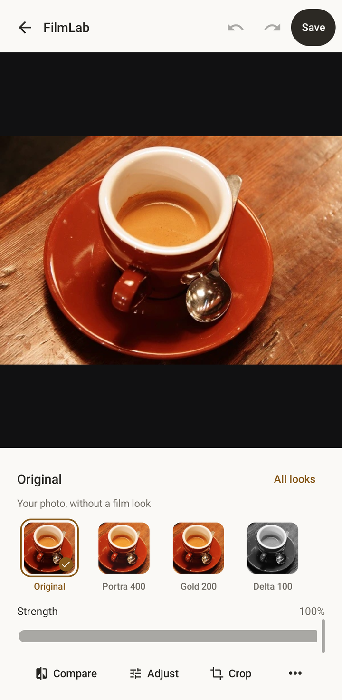

  

<h1 align="center">FilmLab</h1>

A focused Android photo editor with ten film-inspired looks.

Choose a photo, preview the films on your own image, adjust the strength, and save a copy. Processing happens on your device. FilmLab never replaces your original photograph.

  

Captured from FilmLab running on a Pixel 9 Pro Fold.

## Editing a photo

1. Tap **Choose photo** or **Browse files**, continue a recent edit, or send a photo from your gallery through **Share → FilmLab**.
2. Choose a film thumbnail or open **All looks**. Star favourites, or use **My looks** for named recipes. **Original** is selected for a new photo.
3. Adjust **Strength**, then open **Adjust** for Exposure, Warmth, Grain, and CineStill Glow. **Compare** and holding the photo show the original with the same framing. Pinch or double-tap to inspect detail; **Fit** returns to the full image.
4. Use **Crop** for free framing, aspect ratios, quarter-turn rotation, and straightening. **Apply** keeps the crop; **Cancel** keeps the previous framing. **Undo/Redo** includes complete slider gestures, film changes, recipes, and crops.
5. Tap **Save** to choose **Largest available** or **Smaller copy**, save a JPEG to your gallery, or use Android's native sharing sheet. **More** contains Save look and Photo info.

The opening screen shows your current photo and recent edits. Working previews, retained sources, settings, favourites, and recipes stay in private, non-backed-up app storage. Existing single drafts migrate in place. A failed import keeps the previous photograph available.

Recent edits are limited to 20 photographs and 512 MB of retained assets; an individual source can be up to 256 MB. FilmLab reports a full edits folder instead of silently removing older work. Removing an edit never removes your original or exported gallery copies. Deletion can be undone while its message is visible. After dismissal, only that edit's private files are removed; pending deletions are completed on the next launch.

Named looks remember film, strength, exposure, warmth, grain, and glow. Crop stays with each photo. Looks can be renamed and deleted, and applying one can be undone.

The same editor adapts to phones, wide screens, and foldable hinges. It follows the device's light/dark appearance and supports larger text and accessible controls.

## Film looks

Kodachrome 64, Kodak Portra 400, Kodak Gold 200, Fujifilm Velvia 50, CineStill 800T, Fujifilm Pro 400H, Kodak Ektachrome E100, Ilford Delta 100, Ilford HP5 Plus, and Kodak Tri-X 400.

These are artistic simulations using tone curves, colour transforms, procedural grain, and a highlight bloom for CineStill. They are not a claim of measured equivalence to a specific physical film or lab scan.

## Image quality and RAW files

- The editing preview stays at **2,048 pixels on its long edge** for responsive controls. Smaller images are not enlarged.
- **Largest available** renders from the privately retained source in tiles. Crop and straightening reduce the available dimensions; the export sheet shows the actual output size. Full-size JPEG output is limited to 32 million pixels and the device's available rendering budget. Oversized or unsupported region-decoding formats offer **Smaller copy**, which uses the editing preview. Sources are never enlarged.
- An older draft without its source can still export its editing preview. **Reopen original** restores access to a larger source while preserving the edit and framing.
- High-bit-depth RAW sensor development and export are not supported. The largest RAW export is limited to the genuine available preview or Android-decoded image.
- RAW files use their genuine embedded JPEG preview or Android's supported decoder. FilmLab does not develop sensor samples itself; unsupported files fail to open instead of showing an uncalibrated or incomplete image. Info describes the path used.
- Monochrome previews stay monochrome. FilmLab does not invent replacement colours.
- Drafts made by the earlier sensor decoder keep their edits and show a warning to reopen the original RAW file for accurate colour.
- Transparent images are flattened once onto the dark photo background so the preview and saved JPEG use the same pixels.
- Missing camera and sensor details stay unknown rather than being inferred from a brand name.

Your source file is never modified. Native decoding applies all eight EXIF orientations once. Exposure uses linear-light EV adjustments and Warmth changes the red/blue balance before the film look; these controls also work with Original. JPEG editing cannot recover already clipped detail. Grain and glow account for rendering scale and tile coordinates so larger exports keep their intended texture.

Saving and sharing use a frozen edit. Starting another photo cancels the previous export. Cancelling a save removes incomplete or unpublished gallery output. Sharing writes a separate private cache JPEG with a temporary read grant; stale shared copies are removed after 24 hours.

## Build and test

Requirements: JDK 21 and Android SDK platform 36.1 / build tools 36.0.0. The checked-in Gradle wrapper uses Gradle 9.3.1.

    ./gradlew :app:assembleDebug
    ./gradlew :app:testDebugUnitTest

Release builds use **com.nsheremet.filmlab**. Debug builds install as **FilmLab Preview**, package **com.nsheremet.filmlab.debug**, using the standard Android debug key. They can coexist with the release app. These IDs install separately from older FilmLab builds; private edits and preferences remain in the older installation.

Release signing uses KEYSTORE_PATH, STORE_PASSWORD, and KEY_PASSWORD environment variables. Do not commit signing keys or secrets.

## GitHub builds and releases

Every push to `main` builds the preview APK, runs unit tests and lint, and runs the Android tests on an API 36 emulator. APKs and test reports are available in the workflow's artifacts for 14 days.

To publish, update `versionName` and increase `versionCode` in `app/build.gradle.kts`, commit, and push a matching annotated tag such as `v1.0.1`. The tag workflow repeats the checks, builds and verifies the signed release APK, and publishes a GitHub release with the APK and its SHA-256 checksum. A version mismatch or failed check prevents publication. Published releases are never overwritten; rerunning can complete an interrupted draft.

The repository's Actions secrets are `KEYSTORE_BASE64` (base64-encoded JKS, alias `upload`), `STORE_PASSWORD`, and `KEY_PASSWORD`. The release workflow also verifies the public certificate fingerprint. Preserve the signing key and passwords in a secure backup: future APK updates must use the same key. Signing material is never uploaded as a build artifact.

Tests cover film processing and tiled effects, exposure and warmth, crop geometry and EXIF, source retention and draft migration, recipes and deletion undo, interrupted writes and exports, native sharing, and Compose editing journeys. Device tests additionally exercise Android's real region decoder. Robolectric's region-decoder shadow returns empty pixels, so pixel-level renderer unit tests use a test-only native BitmapFactory-backed region shadow.

## Source map

- ui/FilmLabScreen.kt, EditSheets.kt, CropScreen.kt — recent edits, adaptive editor, film/recipe browsing, crop tools, and export/sharing sheets.
- ui/FilmLabViewModel.kt — import/render jobs, history, thumbnails, recipes, recent edits, and export state.
- ui/EditDraftStore.kt, UserLooksStore.kt — atomic private sources/edits and saved recipes/favourites.
- ui/GalleryExporter.kt — verified JPEG writes, gallery publication, and FileProvider sharing.
- ui/RawComponents.kt — source information and export details.
- film/ — film presets, edit settings, shared crop geometry, and tiled image processing.
- raw/ — Android image decoding, camera previews and source metadata.

Generated test scenes in SamplePhotos.kt are fixtures, not real camera captures or proof of RAW colour accuracy.

The welcome photograph is credited in [assets/PHOTO_CREDIT.md](assets/PHOTO_CREDIT.md).
